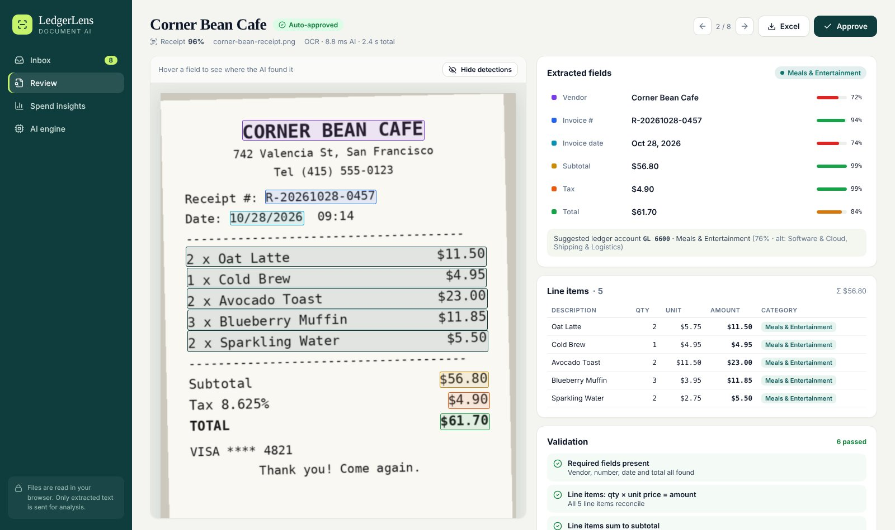

# 🧾 LedgerLens — AI Invoice & Document Extraction



LedgerLens turns invoices, receipts and scanned bills into clean, validated accounting data.
Drop in a PDF or a phone photo. It reads the document, pulls out the key fields and line items,
shows **where on the page** each value came from, checks the math, catches duplicates, assigns a
**GL code**, and exports everything to Excel.

**Stack:** React 18 + Vite + pdf.js + Tesseract.js (frontend) · FastAPI + scikit-learn + openpyxl (backend)

No paid AI API and no API keys. Documents are read **in the browser**; only the positioned text is sent to the API.

---

## ✨ Features

| | |
|---|---|
| **Any document** | Digital PDFs (pdf.js text layer) plus photos and scans through **in-browser OCR** (Tesseract WebAssembly, self-hosted) |
| **Key-field extraction** | Vendor, invoice #, invoice and due dates, PO #, bill-to, subtotal, tax (with rate), shipping, total, currency, email, phone, tax ID, payment terms |
| **Line items** | Reads table rows, columns and continued lines. Receipts without a table header use a fallback parser |
| **Visual grounding** | Every field keeps its bounding box. Hover a value to highlight its source on the page |
| **Confidence scores** | Per field and per document. Results feed a straight-through decision: *auto-approved / needs review / flagged* |
| **Validation** | Checks that qty × price = amount, line items sum to the subtotal, subtotal + tax + shipping = total, the tax amount matches the stated rate, and the due date comes after the invoice date |
| **Fraud and error checks** | Duplicate invoice detection, plus outlier amounts compared with the same vendor's history (z-score) |
| **ML categorisation** | Each line item gets an expense category and **GL code**, and each document gets a type (invoice, receipt, utility bill, PO, credit note) |
| **Human in the loop** | Edit any field inline, approve, and step through a review queue |
| **Spend insights** | Spend by category and vendor, straight-through rate, issues caught, time saved, exceptions queue |
| **Excel export** | Styled workbook with sheets for Documents, Line items, Validation and Spend by category |

## 🧠 How it works

```
 PDF / photo ──► pdf.js text layer ─┐
                 Tesseract OCR  ────┴─► positioned words ──► FastAPI
                                                              │
   1. layout: words → lines → column segments                 │
   2. key-value: label match → value right/below → type check → confidence
   3. tables: header detection → column inference → row parsing
   4. ML: TF-IDF (word + char n-grams) + Logistic Regression
          • expense category / GL code (9 classes)
          • document type (5 classes)
   5. validation & anomaly checks → status
                                                              ▼
                       review UI with highlight boxes · dashboard · Excel export
```

The classifiers are trained when the API starts, on a generated corpus of expense descriptions. They are
evaluated on **held-out phrases never seen in training** (about 95% accuracy for the 9-class expense model).
To specialise them for a client, swap in that client's real ledger history.

## 🚀 Run locally

```bash
# backend
cd backend
pip install -r requirements.txt
uvicorn app.main:app --reload --port 8000

# frontend (new terminal)
cd frontend
npm install
npm run dev          # http://localhost:5173
```

Click **Process all 8 samples** to try it. The samples include a deliberately wrong total and a duplicate
invoice, which LedgerLens flags.

To regenerate the sample documents: `pip install reportlab pillow && python scripts/generate_samples.py`

## ☁️ Deploy

The repo is ready for Vercel. `vercel.json` builds the frontend and serves the FastAPI app as a Python function under `/api`.

## 🔌 API

| Method | Endpoint | Description |
|---|---|---|
| GET | `/api/health` | Status |
| GET | `/api/model` | Classifier metrics, categories and GL codes |
| POST | `/api/extract` | `{file_name, source, pages:[{width,height,words:[{text,x0,y0,x1,y1}]}], history}` → fields, line items, category, checks, status |
| POST | `/api/export` | `{documents:[...]}` → `.xlsx` |

## 📁 Structure
```
backend/app/
  extractor.py    layout reconstruction, key-value & table extraction
  parsing.py      money / date / ID parsers (US & EU formats)
  classifier.py   expense-category & document-type ML models
  validation.py   arithmetic, tax, date, duplicate & outlier checks
  main.py         FastAPI routes + Excel export
frontend/src/
  lib/readers.js  pdf.js + Tesseract readers
  components/     Inbox, Review, Dashboard, Engine
scripts/generate_samples.py   sample invoices (fictional companies)
```

> All companies in the sample documents are fictional.
